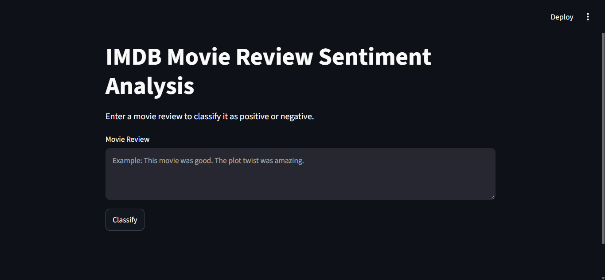
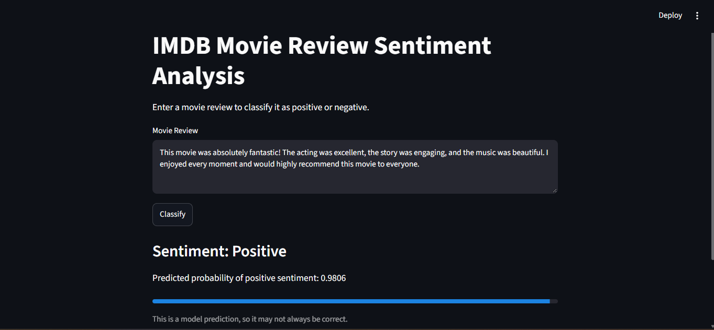
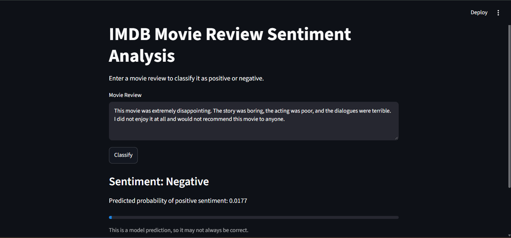

# 🎬 IMDB Movie Review Sentiment Analysis using SimpleRNN

A Deep Learning project that predicts whether a movie review expresses positive or negative sentiment using a Simple Recurrent Neural Network (SimpleRNN). The application provides an interactive user interface built with Streamlit.

## 🔗 Project Live Link


- **Live Demo:** [Add your deployed Streamlit app URL here](https://imdb-movie-review-sentiment-analysis-vr3bmyx8ggfmgo6snk5yhu.streamlit.app/).

## 🖥️ UI Screenshots

### 1. Application Interface


### 2. Positive Review Prediction


### 3. Negative Review Prediction



## ✨ Features

- Predicts positive or negative movie review sentiment.
- Uses a trained SimpleRNN deep learning model.
- Converts text reviews into numerical sequences.
- Uses padding to make input sequences a fixed length.
- Displays predictions through an interactive Streamlit interface.

## 🧠 Model Architecture

| Layer | Configuration |
|---|---|
| Embedding | 10,000 vocabulary size, 64 dimensions |
| SimpleRNN | 32 units, tanh activation |
| Dropout | 0.2 in SimpleRNN |
| Dropout Layer | 0.4 |
| Output Layer | 1 neuron, sigmoid activation |

### Model Configuration

- **Dataset:** IMDB Movie Reviews
- **Maximum Vocabulary:** 10,000 words
- **Maximum Review Length:** 500 tokens
- **Optimizer:** Adam
- **Loss Function:** Binary Cross-Entropy
- **Test Accuracy:** 82.59%

The model produces a probability score for positive sentiment. A threshold of 0.5 is used to classify reviews as positive or negative.

## 🛠️ Technologies Used

- Python
- TensorFlow
- Keras
- NumPy
- Streamlit
- IMDB Dataset

## 📁 Project Structure

```text
imdb-movie-review-sentiment-analysis/
│
├── embeddings.ipynb
├── main.py
├── prediction.ipynb
├── README.md
├── requirements.txt
├── simple_rnn_imdb.h5
├── simplernn.ipynb
│
└── assets/
    ├── Noraml_interface.png
    ├── Positive_prediction.png
    └── Negative_prediction.png
```


## ⚙️ Installation and Setup

### Step 1: Clone the Repository

```bash
git clone https://github.com/vishalrathor001/imdb-movie-review-sentiment-analysis.git
```

### Step 2: Open the Project Folder

```bash
cd imdb-movie-review-sentiment-analysis
```

### Step 3: Create a Virtual Environment

```bash
python -m venv .venv
```

Activate it on Windows:

```bash
.venv\Scripts\activate
```

### Step 4: Install Dependencies

If `requirements.txt` is available:

```bash
pip install -r requirements.txt
```

Otherwise, install the main dependencies:

```bash
pip install tensorflow==2.15.0 streamlit numpy
```

Use a Python version compatible with your TensorFlow version.

### Step 5: Run the Application

Ensure `main.py` and `simple_rnn_imdb.h5` are in the expected locations.

```bash
streamlit run main.py
```

Open the local URL displayed in your terminal, usually:

```text
http://localhost:8501
```

## 📊 Evaluation Results

The model was evaluated on 25,000 held-out IMDB test reviews.

| Metric | Result |
|---|---:|
| Test Accuracy | 82.59% |
| Negative Recall | 83.72% |
| Positive Recall | 81.46% |

These results represent performance on the test dataset. Predictions on individual custom reviews may vary.

## 🚀 Future Improvements

- Compare SimpleRNN with LSTM and GRU models.
- Improve detection of negation and mixed sentiment.
- Add confusion matrix and evaluation visualizations.
- Deploy the application and add the public demo link.

## 👨‍💻 Author

**Vishal Kumar**

- GitHub: [@vishalrathor001](https://github.com/vishalrathor001)

## 📄 License

A license can be added if you plan to distribute this project publicly.
